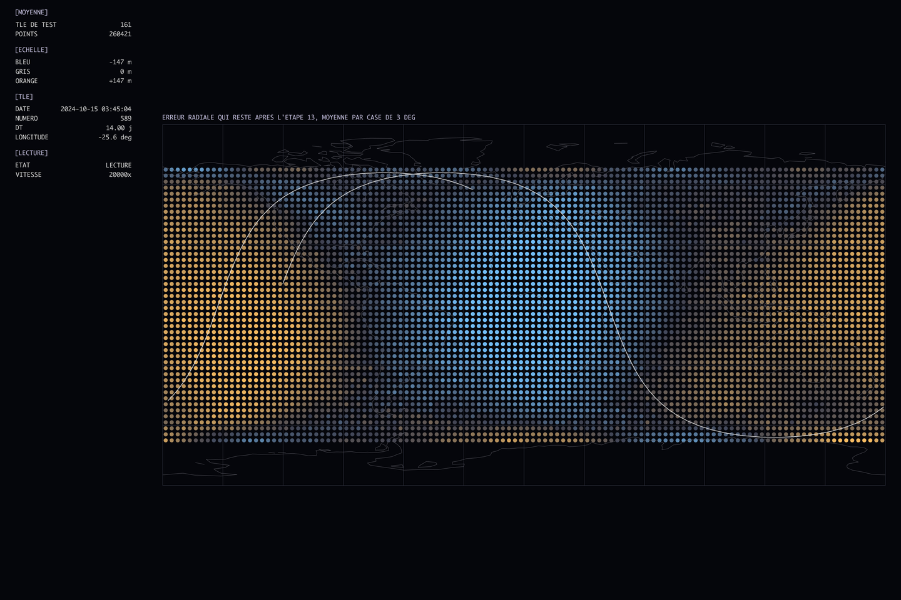

# OrbitML

Correcting satellite orbit predictions with a neural network, after Peng & Bai.
Two weeks out, SGP4, the standard model, places Sentinel-6A 1.9 km from its true
position. A small network trained on precise orbits brings that down to 750 m.
[The project page](https://bourdet.be/projects/orbitml/) tells how it got there.



*The radial error left before the network learns where the satellite is,
averaged over every test TLE: it depends on the longitude, in two opposite lobes.
Rendered with [Aurora](https://github.com/TagCopperLight/Aurora).*

## The notebook

[`orbitml.ipynb`](orbitml.ipynb) builds the correction step by step, from reading
the first precise orbit to the final network. Each choice follows from
what the previous steps showed. On the TLEs of the test period, never seen during
training, the share of the 14-day error left in each direction is:

| correction | R | S | W |
|---|---|---|---|
| none | 100 % | 100 % | 100 % |
| mean error curve | 34 % | 81 % | 39 % |
| network with the inputs of the article | 36 % | 83 % | 36 % |
| final network | 13 % | 39 % | 18 % |

R is radial, S along-track and W perpendicular to the orbit plane. The data is
in `data/`: the 2024 Sentinel-6A precise orbits from DORIS (SP3) and its TLEs. Run it
with [uv](https://docs.astral.sh/uv/) and Python 3.14:

```sh
uv sync
uv run jupyter lab orbitml.ipynb
```

A full run takes more than 10 minutes, most of it training the networks of steps
12 to 15.

## Visualization

`viz/` streams scenes of the notebook to an Aurora viewer, the ones the notebook's
images come from. Aurora is a submodule, and its build needs the dependencies listed
in [its README](https://github.com/TagCopperLight/Aurora#build-and-run).

```sh
git submodule update --init
uv run jupyter execute orbitml.ipynb  # its last cell exports viz/data/orbitml.npz
viz/run.fish 8
```

## References

- H. Peng and X. Bai, *Artificial Neural Network–Based Machine Learning Approach to
  Improve Orbit Prediction Accuracy*, Journal of Spacecraft and Rockets, 55(5), 2018.
- H. Peng and X. Bai, *Machine Learning Approach to Improve Satellite Orbit
  Prediction Accuracy Using Publicly Available Data*, The Journal of the
  Astronautical Sciences, 2019.
